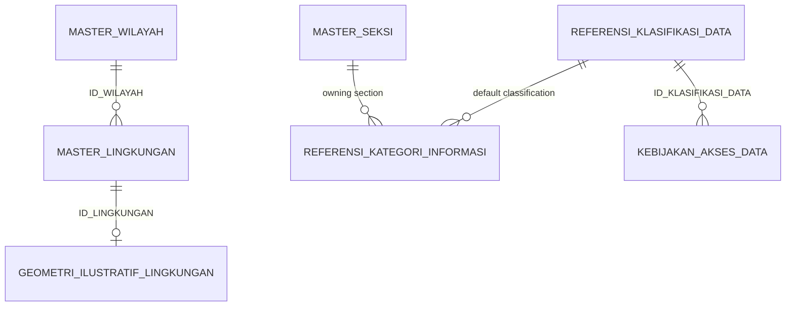
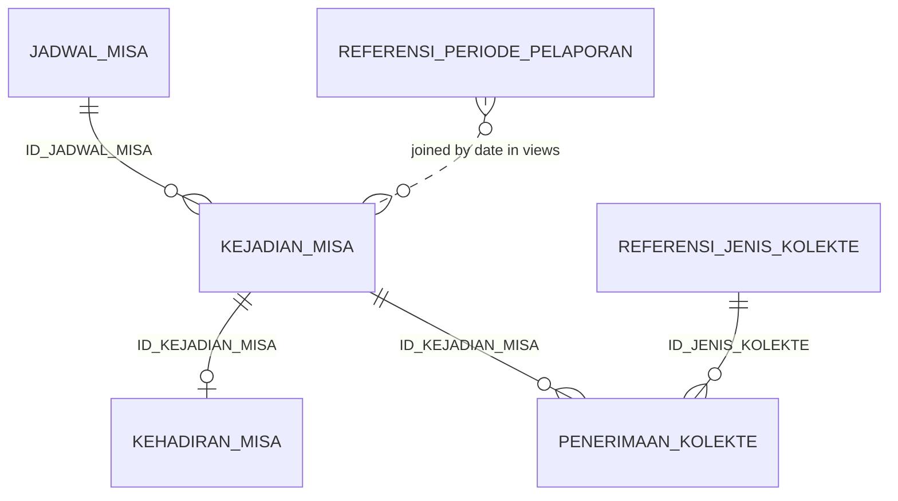
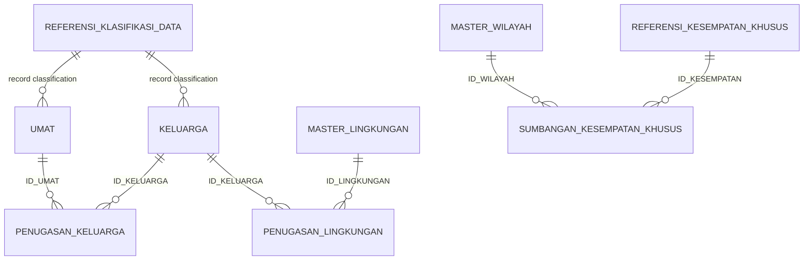
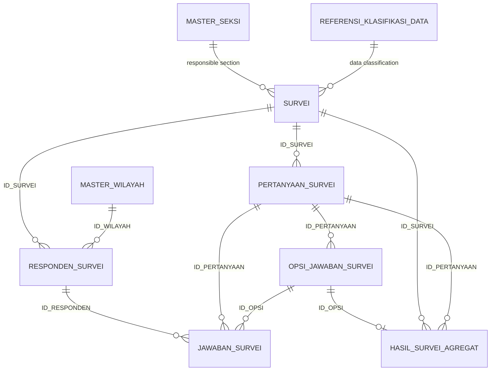
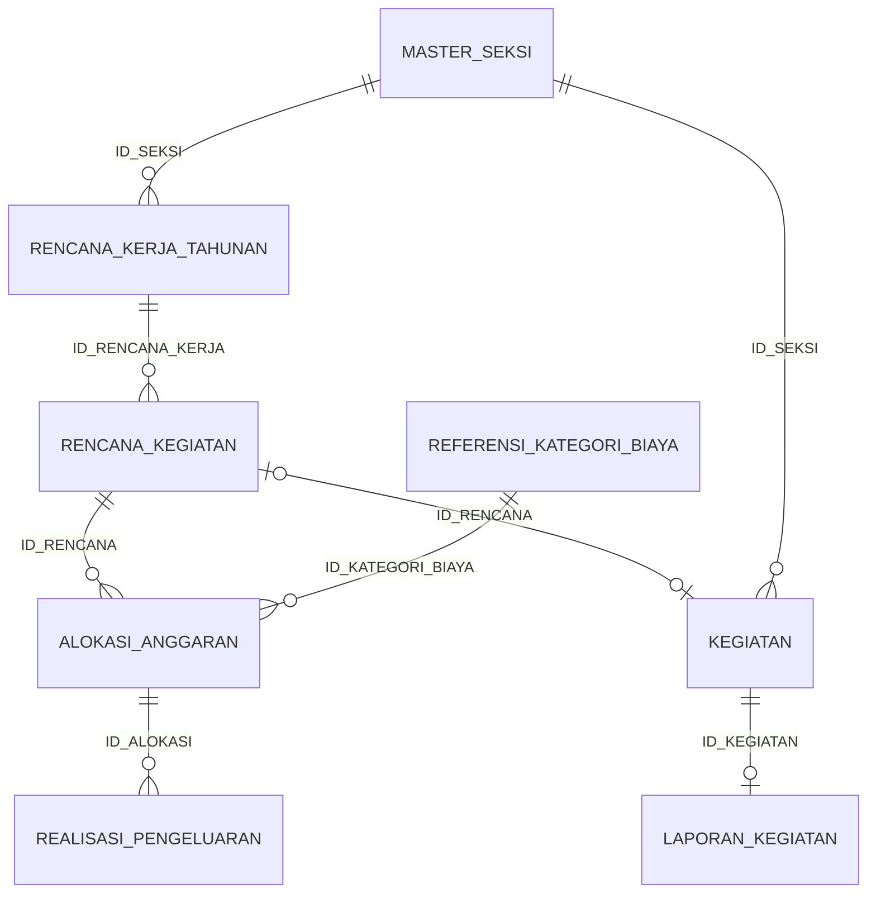

# Data model

Technical description of the Parish Information Hub model: schemas, the nine business domains, how
the tables relate, and why the model looks the way it does. Column-level detail is in the Bahasa
Indonesia [data dictionary](DATA_DICTIONARY.md). The authoritative definition is
[`sql/02_create_tables.sql`](../sql/02_create_tables.sql).

All data is synthetic. This document describes structure only.

## 1. Schemas

| Schema | Holds | Who should see it |
|---|---|---|
| `MASTER_DATA` | Reference lists and master data: regions, communities, sections, Mass schedule rules, survey definitions, controlled vocabularies, reporting calendar, access policy, illustrative geometry. | Internal users |
| `DATA_OPERASIONAL` | Records and transactions: Mass occurrences, attendance, offertory, donations, parishioners, survey responses, plans, budgets, expenditure, events, reports. Includes personal data (fictional) classified *Terbatas*. | Authorised staff only |
| `ANALISIS` | 13 views with aggregated or operational summaries for reporting and the future dashboard. No names or person identifiers. | Dashboards and report readers |

Naming: uppercase snake case, Bahasa Indonesia domain terms, technical English only where it is
standard (`ID`). Identifiers are readable and stable (`MIS-000001`, `LNG-03`, `SEK-05`), and are
deterministic, so reloading never changes a key.

## 2. The nine domains

| # | Domain | Tables | Grain (one row per ...) |
|---|---|---|---|
| 1 | Offertory collections | `PENERIMAAN_KOLEKTE`, `REFERENSI_JENIS_KOLEKTE` | Mass occurrence and collection type |
| 2 | Mass attendance | `KEHADIRAN_MISA` | Mass occurrence |
| 3 | Parishioner database (BIDUK simulation) | `UMAT`, `KELUARGA`, `PENUGASAN_KELUARGA`, `PENUGASAN_LINGKUNGAN`, `REFERENSI_KLASIFIKASI_DATA`, `KEBIJAKAN_AKSES_DATA`, `REFERENSI_KATEGORI_INFORMASI` | person; household; person-household period; household-community period |
| 4 | Special occasion donations | `SUMBANGAN_KESEMPATAN_KHUSUS`, `REFERENSI_KESEMPATAN_KHUSUS` | region, occasion and collection period |
| 5 | Mass schedule master data | `JADWAL_MISA`, `KEJADIAN_MISA` | recurring rule with validity; actual Mass on one date |
| 6 | Surveys | `SURVEI`, `PERTANYAAN_SURVEI`, `OPSI_JAWABAN_SURVEI`, `RESPONDEN_SURVEI`, `JAWABAN_SURVEI`, `HASIL_SURVEI_AGREGAT` | survey; question; option; respondent; answer; option of a summarised question |
| 7 | Annual plans, budgets, actuals | `RENCANA_KERJA_TAHUNAN`, `RENCANA_KEGIATAN`, `ALOKASI_ANGGARAN`, `REALISASI_PENGELUARAN`, `REFERENSI_KATEGORI_BIAYA` | section and year; planned activity; activity and cost category; expenditure transaction |
| 8 | Events and post-event reports | `KEGIATAN`, `LAPORAN_KEGIATAN` | event; report |
| 9 | Regional master data and GIS | `MASTER_WILAYAH`, `MASTER_LINGKUNGAN`, `GEOMETRI_ILUSTRATIF_LINGKUNGAN` | region; community; community polygon |
| - | Shared reference | `MASTER_SEKSI`, `REFERENSI_DAFTAR_NILAI`, `REFERENSI_PERIODE_PELAPORAN` | section; vocabulary value; month |

## 3. Relationships

Arrows read "parent 1 to many children". `o|` means optional (zero or one). The diagrams show
relationships only. Foreign keys are declared in the DDL but **not enforced** by Snowflake on standard
tables, so `sql/06_validate_data.sql` checks every one of them.

### Regions, communities, classification

### Mass schedule, attendance, offertory

`ID_KEJADIAN_MISA` is the shared key: attendance and offertory exist only for occurrences that were held.

### Parishioners and donations

### Surveys

### Plans, budgets, events, reports

## 4. Design decisions

1. **One source of truth for structure.** The generator parses the DDL for column order, types, keys and nullability, and the data dictionary is built from the DDL comments. A new column therefore cannot exist in one place only. Tests fail when they disagree.
2. **Region and community are two tables** (`MASTER_WILAYAH` 1-to-many `MASTER_LINGKUNGAN`) instead of one denormalised table, in line with the rule not to repeat reference attributes. `ANALISIS.STRUKTUR_WILAYAH` provides the flattened view that `CLAUDE.md` sketches.
3. **Schedule rules are separate from occurrences.** `JADWAL_MISA` holds weekly rules with a validity period, and `KEJADIAN_MISA` holds what actually happened on a date. Scheduled times live only on the rule and actual times only on the occurrence, so the two can never be confused. The demo moves the Saturday Mass from 17:00 to 17:30 on 1 July 2026; both rules share the name `Misa Sabtu Sore`, so monthly reports continue as one session.
4. **Attendance and offertory exist only for held Masses.** Cancelled and future occurrences (`Dibatalkan`, `Terjadwal`) carry neither. Offertory keeps three separate facts: the amount recorded at the Mass, the amount counted later, and the reconciliation status. The difference is derived in views, never stored.
5. **Households, not individuals, belong to a community.** A community is a place-based group, so the household is assigned (`PENUGASAN_LINGKUNGAN`); a person's community and region are derived through the household. Both assignment tables are effective-dated (`TANGGAL_MULAI_BERLAKU`, `TANGGAL_AKHIR_BERLAKU`, an empty end date meaning "current"), so moves and mergers add rows instead of overwriting history. The demo includes a merged community, relocations, and adult children who start their own household.
6. **Privacy by design in the parishioner model.** Only a birth *year* is stored. There is no column for identity number, phone, address or e-mail (a test enforces this). Records carry a classification: *Terbatas* for adults, *Sangat Terbatas* for people under 17. Data classification and an illustrative access matrix are modelled as data (`REFERENSI_KLASIFIKASI_DATA`, `KEBIJAKAN_AKSES_DATA`).
7. **Survey respondents are anonymous.** `RESPONDEN_SURVEI` has no link to `UMAT` and keeps only a coarse age group and the region. `HASIL_SURVEI_AGREGAT` stores the aggregates a dashboard needs, with the denominator (`TOTAL_RESPONDEN_PERTANYAAN`) so a percentage can be audited, and the validation script recomputes counts and totals from the raw answers. Skipped questions have no answer row, so questions can have different totals. A survey that has not started has no responses and no aggregates.
8. **Plans, budgets and actuals are separate entities.** The planned amount (`ALOKASI_ANGGARAN`) and the spent amount (`REALISASI_PENGELUARAN`) are different tables; `ANGGARAN_RENCANA` and `ANGGARAN_TERPAKAI` exist only as view columns. The demo has completed, postponed, cancelled and future activities, activities with no spending, partly used budgets and one overspent programme.
9. **An event is optional for a plan, and a report is optional for an event.** A plan has at most one event (`UNIQUE` on `KEGIATAN.ID_RENCANA`). Unplanned events have an empty `ID_RENCANA`. `ID_SEKSI` is repeated on the event on purpose so unplanned events have a section, and a validation rule keeps it equal to the plan's section. Reports can be final, draft (with missing fields), under revision, or absent.
10. **Controlled vocabularies are data.** Status and category labels are stored as readable Indonesian labels (`Sudah Divalidasi`), which keeps queries and dashboards simple, and are listed in `REFERENSI_DAFTAR_NILAI` by group. The validation script verifies every column against its group. A single generic table was chosen over about twenty tiny code tables; a composite foreign key is not possible because the child tables do not store the group.
11. **Illustrative geometry only.** `GEOMETRI_ILUSTRATIF_LINGKUNGAN` stores GeoJSON as text, flagged `BERSIFAT_SINTETIS`. The rectangles are placed at 0°N 0°E, a location with no parish, so nobody can mistake them for real boundaries. No Snowflake spatial type or function is needed at this stage; `TO_GEOGRAPHY` can be applied later. Spatial analysis is Phase 3.
12. **Time is fixed.** The dataset is a snapshot at **2026-09-30** (`scripts/mockdata/config.py`), with Mass occurrences from April to October 2026. Nothing uses today's date, so results are reproducible and the validation does not change from day to day.
13. **Idempotent loading.** Each table is loaded with `MERGE` on its primary key, from inline `VALUES`. No stages, files or external services are needed in a trial account, and re-running neither duplicates nor deletes rows.
14. **No ranking, no spirituality metrics.** Offertory views report amounts and reconciliation status only and never compute per-attendee or per-person figures. The donation view has no rank column and carries a usage note. The data dictionary states that neither measures faith or commitment.

## 5. Where the suggested attributes of `CLAUDE.md` went

The model keeps every suggested attribute. These were deliberately placed differently:

| Suggested in `CLAUDE.md` | Where it is | Why |
|---|---|---|
| `KLASIFIKASI_DATA` | `ID_KLASIFIKASI_DATA` (foreign key) | Classification is a reference list with its own attributes. |
| `ID_SEKSI`, `TAHUN_RENCANA` on the plan | `RENCANA_KERJA_TAHUNAN`; the planned activity points to it | Section and year belong to the annual plan, not to each activity. `ANALISIS.ANGGARAN_VS_REALISASI_PROGRAM` shows them flat. |
| `ANGGARAN_RENCANA`, `ANGGARAN_TERPAKAI` | Sums of `ALOKASI_ANGGARAN` and `REALISASI_PENGELUARAN`, as view columns | Planned and actual values stay separate and cannot disagree. |
| `NAMA_KESEMPATAN` on the donation | `REFERENSI_KESEMPATAN_KHUSUS` | The same occasion recurs each year. |
| `KATEGORI_JAWABAN` on the aggregate | `OPSI_JAWABAN_SURVEI`, joined in `ANALISIS.HASIL_SURVEI` | The label is defined once per option. |
| `ID_UMAT, ID_KELUARGA, ID_LINGKUNGAN` in one assignment | Two assignment tables (person to household, household to community) | Matches the real relationships and keeps both histories. |
| `NAMA_WILAYAH, NAMA_LINGKUNGAN` in one table | Two tables, joined in `ANALISIS.STRUKTUR_WILAYAH` | See decision 2. |
| `REALISASI_BIAYA` on the post-event report | Kept on `LAPORAN_KEGIATAN`, but understood as the cost *claimed by the report* and compared with the recorded expenditure by a warning check | A report can disagree with the books. |
| `tests/validation_queries.sql` | Validation SQL lives only in `sql/06_validate_data.sql`; `tests/` holds Python tests | Avoids two copies of the same checks. |
| `app/README.md` | Not created | Phase 2 has not started. |

## 6. Data classification and access

| Level | Examples | Dashboard use |
|---|---|---|
| Publik | Mass schedule, region list | Allowed |
| Internal | Attendance, offertory, plans, budgets, aggregated survey results | Internal reporting only |
| Terbatas | Households, individuals, assignments, anonymous survey answers | Never as detail |
| Sangat Terbatas | Individuals under 17 | Never |

`ANALISIS` is the only schema meant for dashboards. A view in Snowflake runs with its owner's
privileges, so a dashboard role needs only `USAGE` on the database and the `ANALISIS` schema and
`SELECT` on its views, without any access to `DATA_OPERASIONAL`. Implementing roles and grants is
Phase 3 and is not part of this repository. The validation script confirms that no `ANALISIS` view
exposes a name, a person or household identifier, or a birth year.

## 7. Limits of this version

* All data is generated. There is no integration with real sources and no ingestion pipeline.
* Primary, unique and foreign keys are declarative metadata; consistency is verified, not enforced.
* Table definitions are created with `IF NOT EXISTS`, so there is no migration mechanism yet.
* The parish is deliberately small (about 650 simulated parishioners), so attendance and counts are in proportion. The numbers describe nobody.
* The SQL has been tested on a stand-in engine, not on Snowflake itself.
